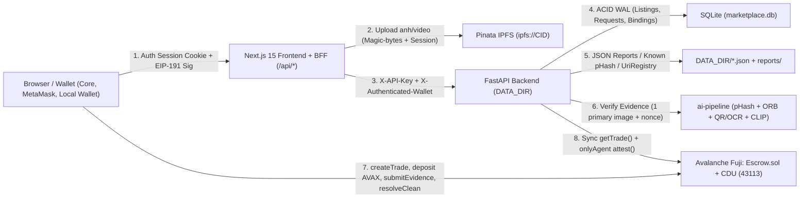
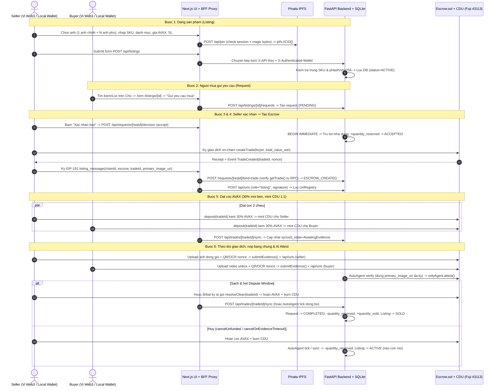

# MKT-001 — Marketplace Architecture Review & Upgrade Blueprint

- **Task ID:** `MKT-001`
- **Project:** `D:\Escrow_Marketplace_Demo`
- **Ngày lập:** 2026-11-14
- **Baseline Git HEAD:** `bdb1e13` (kèm các thay đổi local đang mở tại `frontend/` về Auth/Core wallet)
- **Trạng thái:** `IN_REVIEW` (Chỉ khảo sát & thiết kế kiến trúc — **chưa sửa application code**, chờ Project Owner duyệt trước khi mở `MKT-002`..`MKT-005`)
- **Mạng mục tiêu:** Avalanche Fuji Testnet (`chainId: 43113`) · Local dev Anvil (`31337`)

---

## 1. Tóm Tắt Kiểm Tra Hiện Trạng (Context Freshness & Architecture Audit)

### 1.1. Context Freshness (`AGENTS.md §1.5`)

Toàn bộ 9 file trong `docs/context/*.md` hiện **chưa có header `Verified against commit:`**. Khi đối chiếu trực tiếp với code tại `bdb1e13` và file deploy thực tế:

| Tài liệu | Sai lệch đã xác minh với code hiện tại | Mức ảnh hưởng |
|---|---|---|
| `docs/context/TECH_STACK.md` | Ghi `Frontend: NOT STARTED`. Thực tế `frontend/` đã hoàn thiện Next.js `15.5.29`, React `18.3.1`, wagmi `2.14.9`, viem `2.21.58`, Tailwind `3.4.1`, EIP-6963 multi-wallet + Local Wallet (`AES-256-GCM`), session cookie HMAC. | Cao (dễ gây hiểu nhầm stack FE) |
| `docs/context/CURRENT_STATUS.md` | Ghi địa chỉ Escrow Fuji `0x1F048Bc735CF0277FeFd3fAaA3dA7d8d2c4cCbCf`. Theo `contracts/deployments/43113.json` (nguồn ưu tiên #3 theo `AGENTS.md §0`), địa chỉ thực đang deploy là `0x19D053c84941411888f5b9e40c854365fdd4eb00` (`deployBlock: 60980241`, token `0xD0c99809e2F035Bf9d99cCB0593A9cc4B6411F78`). | Cao |
| `.agents/rules/60-ui-ux.md` | Ghi `Next.js 14`, trong khi `frontend/package.json` dùng `next: 15.5.29`. | Thấp |
| `backend/Dockerfile` | Chỉ `COPY` `attest_service.py` và `chain.py`, **thiếu `backend/auto_agent.py`** (nếu build Docker sẽ `ModuleNotFoundError` vì `attest_service.py` import `auto_agent`). | Trung bình |

### 1.2. Hiện trạng 6 lớp kiến trúc

1. **Smart Contract (`contracts/src/Escrow.sol`, `CollectibleToken.sol`):**
   - `Escrow.sol` (`0x19D053c84941411888f5b9e40c854365fdd4eb00` trên Fuji `43113`, `evidenceWindow=600s`, `attestWindow=600s`, `disputeWindow=90s`) quản lý giao dịch P2P 1-1:
     - `createTrade(address buyer, uint256 itemValue)` bắt buộc `msg.sender` (seller) truyền đích danh `buyer != address(0) && buyer != msg.sender` và `itemValue` (sao cho `depositRequired = itemValue * 3000 / 10000 > 0`).
     - Không có khái niệm `listingId`, `sku`, `category`, `quantity`, hay sổ yêu cầu mua trên contract.
     - State machine 6 trạng thái: `Created (0) → AwaitingEvidence (1) → Attested (2) → Disputed (3) / Resolved (4) / Cancelled (5)`.
   - `CollectibleToken.sol` (`CDU`, `0xD0c99809e2F035Bf9d99cCB0593A9cc4B6411F78`): ERC-20 **Soulbound** (`_update` chặn transfer giữa ví), mint 1:1 khi nạp AVAX cọc 30%, burn 1:1 khi hoàn cọc/giải ngân/tranh chấp (`DEC-004`).

2. **Backend (`backend/attest_service.py`, `backend/auto_agent.py`, `backend/chain.py`):**
   - FastAPI Python 3.12, dùng chung lõi `run_verification` cho cả thủ công (`POST /verify-evidence`) và agent nền (`AutoAgent` quét `nextTradeId()` mỗi `agent_poll_seconds`).
   - Đã có cơ chế bảo mật fail-closed trên `chain_id != 31337`: bắt buộc `ATTEST_API_KEY` khác rỗng, `ALLOW_LOCAL_HOSTS=false`, `ENFORCE_EVIDENCE_HASH=true` (nếu sai trả HTTP `503 INSECURE_CONFIG`).
   - Đã có SSRF check + allowlist gateway khi tải ảnh/video từ `ipfs://`.
   - `POST /trade/{id}/uris` xác thực ảnh niêm yết gốc (`role="listing"`) bằng **chữ ký EIP-191 của `seller`** khớp chuỗi `listing_message(chain_id, escrow_address, trade_id, uri)`.
   - ABI Parity: `backend/abi/Escrow.json` và `frontend/lib/abi/Escrow.json` hiện trùng SHA256 (`4E7CC05C...`), `CollectibleToken.json` trùng SHA256 (`C91BE5D6...`).

3. **Database & Lưu trữ hiện tại:**
   - **Chưa có database dùng chung.**
   - `backend/` lưu 3 tệp cục bộ dưới `DATA_DIR` (`./data`): `known_hashes.json` (`KnownHashStore` pHash), `trade_uris.json` (`UriRegistry`), và `reports/<trade_id>.json`. `AutoAgent.status` nằm trong RAM.
   - `frontend/` lưu tên món hàng, mô tả và `listingUri` vào **`localStorage` của trình duyệt** (`meta:${chainId}:${tradeId}`, `listing:${chainId}:${tradeId}`), dẫn đến người mua hoặc thiết bị khác không thấy thông tin sản phẩm, không có catalog để duyệt, tìm kiếm hay lọc.

4. **IPFS (`frontend/app/api/pin/route.ts`, `frontend/lib/ipfs.ts`):**
   - Upload qua Next.js server route `/api/pin` dùng `PINATA_JWT` phía server (bắt buộc session cookie).
   - **Khoảng trống bảo mật đã phát hiện:**
     - `/api/pin` hiện mới kiểm tra `file.type` (header client gửi), **chưa kiểm tra magic bytes** theo yêu cầu `.agents/rules/70-security.md`.
     - Khi thiếu `PINATA_JWT`, `/api/pin` tự trả `ipfs://mock...` bất kể `chainId` (`43113` hay `31337`), vi phạm `.agents/rules/70-security.md` (cấm mock CID ngoài chain `31337`).

5. **AI Pipeline (`ai-pipeline/evidence_check.py`):**
   - Pipeline 4 lớp: pHash reuse detection + ORB keypoint matching + CLIP/HSV semantic similarity + QR/OCR nonce (8 hex đầu).
   - Hiện nhận **1 ảnh niêm yết tham chiếu** (`listing_image_url`), 1 ảnh đóng gói seller, 1 ảnh/video mở hộp buyer → xuất `EvidenceReport` + `reportHash`.

6. **Frontend, Wallet & Authentication (`frontend/`):**
   - Wallet: EIP-6963 multi-wallet (`Core`, `MetaMask`, `Rainbow`, `Base`, `WalletConnect`) + Ví trình duyệt (`local-wallet`: BIP-39 + AES-256-GCM).
   - Auth: `POST /api/auth/session` verify chữ ký EIP-191, cấp cookie HttpOnly HMAC-SHA256 (`escrow_auth_session`).
   - `AuthGuard.tsx`: Hiện chặn **toàn bộ route ngoài `/auth` và `/auth/local`** nếu chưa xác thực ví + session + đúng mạng `43113`.
   - Trang `/` hiện tại (`frontend/app/page.tsx`) là trang giới thiệu + bảng `Giao Dịch Của Tôi` + Design System showcase, chưa phải trang Chợ sản phẩm (Marketplace-first).

---

## 2. Kiến Trúc Đề Xuất (Target Marketplace Architecture)

Nguyên tắc cốt lõi: **Mở rộng lớp Marketplace hoàn toàn ở Off-chain (`SQLite Shared DB` + `FastAPI` + `Next.js BFF Proxy` + `Marketplace UI`) và nối sạch vào `Escrow.createTrade(buyer, itemValue)`**, giữ nguyên 100% Smart Contract, ABI, Wallet, Auth và quy tắc AI Authority (`55-ai-authority.md`).



### 2.1. Phân tách trách nhiệm các lớp

1. **Database dùng chung đề xuất — SQLite (WAL mode) tại `DATA_DIR/marketplace.db` trong `backend/`:**
   - **Vì sao chọn SQLite (WAL) thay vì dựng Postgres/DB riêng trên Next.js:**
     - Không cài thêm server/dependency ngoài (`sqlite3` có sẵn trong Python 3.12 stdlib), chạy ngay cùng `DATA_DIR` Docker volume và cùng `AutoAgent` tick loop hiện tại.
     - Hỗ trợ transaction `BEGIN IMMEDIATE` để **giữ chỗ tồn kho nguyên tử (atomic reservation)** và **chống đăng bán trùng** bằng `UNIQUE` partial index.
     - Dùng chung `imagehash` sẵn có trong môi trường Python của `backend/` để kiểm tra trùng ảnh pHash ngay khi tạo listing.
     - Thiết kế SQL chuẩn quan hệ + lớp `db.py` tách biệt để nếu triển khai multi-instance/cloud sau này có thể đổi sang PostgreSQL với minimal diff.
   - *(Lưu ý vận hành: `frontend/` giao tiếp với DB **thông qua FastAPI backend**, không đọc file `.db` trực tiếp, giữ đúng ranh giới module trong `.agents/rules/20-architecture.md`.)*

2. **Ràng buộc an toàn Wallet & Authentication (Không sửa flow ví/session hiện tại):**
   - Người dùng đăng nhập 1 lần qua `/auth` hoặc `/auth/local` → nhận cookie HttpOnly `escrow_auth_session` (đã xác thực EIP-191 + `chainId`).
   - **Next.js BFF Proxy (`/api/listings/**`, `/api/requests/**`, `/api/trades/*/sync`)**:
     - API đọc (`GET /api/listings`, `GET /api/listings/[id]`): phục vụ công khai danh mục/chi tiết (hoặc theo trạng thái `AuthGuard`, xem Mục 6.1).
     - API ghi (`POST/PATCH/DELETE`): Next.js verify cookie `verifySessionFromRequest(request)` → trích `session.address` & `session.chainId` → gửi sang FastAPI kèm `X-API-Key: ATTEST_API_KEY` + `X-Authenticated-Wallet: <address>` + `X-Authenticated-Chain-Id: <chainId>`.
   - **FastAPI Backend**:
     - Tiếp tục chặn `401` mọi request ghi không có `X-API-Key` hợp lệ (và `503 INSECURE_CONFIG` trên Fuji `43113` nếu thiếu `ATTEST_API_KEY`). Nhờ đó client ngoài **không thể** gọi thẳng port `8000` để giả mạo `X-Authenticated-Wallet`.
     - Kiểm tra quyền sở hữu trên từng tài nguyên (`listing.seller_wallet == actor`, `request.buyer_wallet == actor`).
     - Riêng thao tác gắn ảnh gốc cho AI Agent vẫn giữ **chữ ký EIP-191 `listing_message(...)` của Seller** tại `POST /trade/{id}/uris` (`DEC-016`).

---

## 3. Mô Hình Dữ Liệu Off-chain vs On-chain (Data Model)

### 3.1. Phân chia Off-chain vs On-chain (Yêu cầu 5 & 6)

| Thành phần dữ liệu | Nơi lưu trữ | Ai ghi | Lý do |
|---|---|---|---|
| Metadata sản phẩm: `listing_id`, `sku`, `category`, `title`, `description`, `condition`, `quantity_*`, `status`, danh sách nhiều ảnh | **Off-chain (SQLite DB + IPFS)** | Seller qua `/api/listings` | Không phình state on-chain; hỗ trợ search, filter, tồn kho, nhiều ảnh như Shopee mà **không sửa `Escrow.sol`** |
| Ảnh sản phẩm (`primary_image` + `gallery`) & SHA-256 / pHash | **IPFS (Pinata) + DB (`listing_images`, `listing_hashes`)** | Seller (upload `/api/pin`) + Backend (tính sha256/phash) | Giữ file phi tập trung trên IPFS; hash pHash giúp chống đăng bán trùng ở DB |
| Yêu cầu mua hàng (`PurchaseRequest`: số lượng, ghi chú, TTL giữ chỗ) | **Off-chain (SQLite DB)** | Buyer tạo; Seller accept/reject | `Escrow.sol` yêu cầu biết sẵn địa chỉ `buyer` lúc `createTrade`; cần bước thương lượng/giữ chỗ trước khi ký tx |
| Liên kết `listing_id` ↔ `request_id` ↔ `trade_id` & cache `synced_state` | **Off-chain (SQLite DB `listing_trades`)** | Backend (chỉ ghi sau khi verify tx + `getTrade()` từ RPC) | `Escrow.sol` không có trường `listingId`; backend xác thực chéo từ chain trước khi link |
| Giao dịch ký quỹ: `seller`, `buyer`, `itemValue`, `depositRequired` (30% AVAX), `nonce`, `evidenceHash`, `riskScore`, `flagged`, `reportHash`, `state` | **On-chain (`Escrow.sol`)** | Seller, Buyer, `onlyAgent`, `onlyOwner` | Nguồn sự thật tối hậu (`AGENTS.md §0`); giữ cọc AVAX thật trên Fuji |
| Token kế toán ký cược `CDU` (`CollectibleToken`) | **On-chain (`CollectibleToken.sol`)** | Chỉ `Escrow.sol` (`mint`/`burn` 1:1) | Soulbound token đối ứng 1:1 AVAX cọc; **không thêm token thanh toán mới** |

### 3.2. Lược đồ SQLite (`DATA_DIR/marketplace.db`)

```sql
-- 1. Tin đăng bán đồ sưu tầm
CREATE TABLE listings (
    id TEXT PRIMARY KEY,                         -- ULID/UUID, vd "lst_01J..."
    chain_id INTEGER NOT NULL,                   -- 43113 (Fuji) hoặc 31337 (Anvil)
    escrow_address TEXT NOT NULL,                -- lowercase contract address để phân tách theo bản deploy
    seller_wallet TEXT NOT NULL,                 -- lowercase 0x...
    sku TEXT NOT NULL,                           -- lưu bản hiển thị; chuẩn hóa TRIM/UPPER ở sku_norm
    sku_norm TEXT NOT NULL,                      -- UPPER(TRIM(sku))
    category TEXT NOT NULL CHECK (category IN ('LEGO', 'MODEL_KIT', 'FIGURE', 'TRADING_CARD', 'COIN', 'OTHER')),
    title TEXT NOT NULL,
    description TEXT NOT NULL DEFAULT '',
    price_wei TEXT NOT NULL,                     -- string số nguyên wei (tránh mất độ chính xác JS/float), > 0
    condition TEXT NOT NULL CHECK (condition IN ('SEALED_NEW', 'LIKE_NEW', 'USED_GOOD', 'USED_FAIR', 'GRADED')),
    quantity_total INTEGER NOT NULL CHECK (quantity_total >= 1),
    quantity_reserved INTEGER NOT NULL DEFAULT 0 CHECK (quantity_reserved >= 0),
    quantity_sold INTEGER NOT NULL DEFAULT 0 CHECK (quantity_sold >= 0),
    primary_image_uri TEXT NOT NULL,             -- ipfs://... dùng làm listing_image_url khi AI verify
    primary_image_sha256 TEXT NOT NULL,          -- hex sha256 bytes ảnh chính
    primary_image_phash TEXT NOT NULL,           -- 64-bit hex pHash từ ai-pipeline/imagehash
    status TEXT NOT NULL CHECK (status IN ('ACTIVE', 'RESERVED', 'SOLD', 'PAUSED', 'CANCELLED')),
    created_at INTEGER NOT NULL,
    updated_at INTEGER NOT NULL,
    CHECK (quantity_reserved + quantity_sold <= quantity_total)
);

-- Chống cùng 1 seller đăng trùng SKU khi sản phẩm còn đang mở bán hoặc đang được giữ chỗ
CREATE UNIQUE INDEX uq_active_seller_sku
ON listings (chain_id, escrow_address, seller_wallet, sku_norm)
WHERE status IN ('ACTIVE', 'RESERVED', 'PAUSED');

CREATE INDEX idx_listings_browse ON listings (chain_id, status, category, created_at DESC);
CREATE INDEX idx_listings_seller ON listings (chain_id, seller_wallet, created_at DESC);
CREATE INDEX idx_listings_sha256 ON listings (chain_id, primary_image_sha256);

-- 2. Thư viện nhiều ảnh cho mỗi tin đăng (ảnh chính + ảnh phụ chi tiết góc/hộp/tem)
CREATE TABLE listing_images (
    id INTEGER PRIMARY KEY AUTOINCREMENT,
    listing_id TEXT NOT NULL REFERENCES listings(id) ON DELETE CASCADE,
    cid TEXT NOT NULL,
    uri TEXT NOT NULL,                           -- ipfs://<cid>
    sha256 TEXT,
    sort_order INTEGER NOT NULL DEFAULT 0,
    is_primary INTEGER NOT NULL DEFAULT 0 CHECK (is_primary IN (0, 1))
);
CREATE UNIQUE INDEX uq_listing_one_primary ON listing_images (listing_id) WHERE is_primary = 1;

-- 3. Yêu cầu mua hàng (Buyer gửi -> Seller xác nhận giữ chỗ -> Tạo Escrow)
CREATE TABLE purchase_requests (
    id TEXT PRIMARY KEY,                         -- ULID/UUID, vd "req_01J..."
    listing_id TEXT NOT NULL REFERENCES listings(id),
    chain_id INTEGER NOT NULL,
    seller_wallet TEXT NOT NULL,
    buyer_wallet TEXT NOT NULL,
    quantity INTEGER NOT NULL CHECK (quantity >= 1),
    unit_price_wei TEXT NOT NULL,                -- snapshot giá tại thời điểm gửi yêu cầu
    total_value_wei TEXT NOT NULL,               -- = unit_price_wei * quantity (truyền vào createTrade)
    buyer_note TEXT NOT NULL DEFAULT '',         -- ghi chú giao nhận/đóng gói (không chứa PII nhạy cảm bắt buộc)
    seller_note TEXT NOT NULL DEFAULT '',
    status TEXT NOT NULL CHECK (status IN (
        'PENDING', 'ACCEPTED', 'REJECTED', 'CANCELLED',
        'EXPIRED', 'ESCROW_CREATED', 'COMPLETED', 'TRADE_CANCELLED'
    )),
    reservation_expires_at INTEGER,              -- TTL khi ACCEPTED nhưng seller chưa gọi createTrade (vd +24h)
    created_at INTEGER NOT NULL,
    updated_at INTEGER NOT NULL
);
CREATE INDEX idx_requests_listing ON purchase_requests (listing_id, status);
CREATE INDEX idx_requests_buyer ON purchase_requests (chain_id, buyer_wallet, created_at DESC);
CREATE INDEX idx_requests_seller ON purchase_requests (chain_id, seller_wallet, status, created_at DESC);

-- 4. Ánh xạ 1-1 giữa Purchase Request <-> On-chain Trade ID
CREATE TABLE listing_trades (
    id INTEGER PRIMARY KEY AUTOINCREMENT,
    chain_id INTEGER NOT NULL,
    escrow_address TEXT NOT NULL,
    trade_id INTEGER NOT NULL,
    listing_id TEXT NOT NULL REFERENCES listings(id),
    request_id TEXT NOT NULL UNIQUE REFERENCES purchase_requests(id),
    tx_hash TEXT NOT NULL,
    synced_state TEXT NOT NULL,                  -- Created | AwaitingEvidence | Attested | Disputed | Resolved | Cancelled
    flagged INTEGER NOT NULL DEFAULT 0,
    last_synced_at INTEGER NOT NULL,
    UNIQUE (chain_id, escrow_address, trade_id)
);
```

### 3.3. Quy tắc chống đăng bán trùng & giữ chỗ nguyên tử (Yêu cầu 3)

1. **Chống đăng bán trùng SKU đang giữ chỗ / đang mở:**
   - Chuẩn hóa `sku_norm = sku.strip().upper()` (`^[A-Z0-9._-]{2,64}$`).
   - Partial unique index `uq_active_seller_sku` chặn tuyệt đối một seller tạo 2 tin đăng trùng SKU khi bản ghi cũ còn ở `ACTIVE`, `RESERVED`, hoặc `PAUSED`. Chỉ khi đơn cũ đã `SOLD` hoặc `CANCELLED` (tất cả `quantity_reserved == 0`) mới được đăng lại SKU đó.
2. **Chống đăng bán trùng bằng hình ảnh khi đang giữ chỗ:**
   - Khi `POST /listings` (hoặc `PATCH` ảnh chính) nhận `primary_image_uri`: backend tải ảnh (qua `download()` đã có SSRF protection + allowlist gateway) → tính `sha256` và `phash` bằng `ai-pipeline`.
   - Kiểm tra các listing đang có trạng thái `ACTIVE` hoặc `RESERVED` (hoặc `quantity_reserved > 0`) trên cùng `(chain_id, escrow_address)`:
     - Nếu trùng tuyệt đối `primary_image_sha256` → từ chối `409 Conflict` (`DUPLICATE_LISTING_IMAGE`).
     - Nếu cùng seller và khoảng cách Hamming pHash `<= PHASH_REUSE_THRESHOLD (8)` → từ chối `409 Conflict` (`DUPLICATE_RESERVED_PRODUCT`).
   - *(Ghi chú: Tách biệt `listings.primary_image_phash` khỏi `known_hashes.json` của AI pipeline để không gây false-positive tự trùng ảnh khi chạy `/verify-evidence` cho chính listing đó).*
3. **Bảo vệ sản phẩm đang có giữ chỗ (`quantity_reserved > 0`):**
   - Seller **không thể** đổi `price_wei`, đổi `primary_image_uri`, giảm `quantity_total < quantity_reserved + quantity_sold`, hoặc `DELETE/CANCEL` listing khi `quantity_reserved > 0`.
4. **Chống oversell khi Seller xác nhận yêu cầu (`accept`):**
   - Thực hiện trong SQLite `BEGIN IMMEDIATE`:
     ```sql
     UPDATE listings
     SET quantity_reserved = quantity_reserved + :req_qty,
         status = CASE
             WHEN (quantity_total - (quantity_reserved + :req_qty) - quantity_sold) = 0 THEN 'RESERVED'
             ELSE 'ACTIVE'
         END,
         updated_at = :now
     WHERE id = :listing_id
       AND status = 'ACTIVE'
       AND (quantity_total - quantity_reserved - quantity_sold) >= :req_qty;
     ```
   - Nếu `rowcount == 0` → trả `409 Conflict` ngay lập tức, không bao giờ cấp giữ chỗ cho 2 buyer cùng lúc trên món chỉ có `quantity = 1`.

---

## 4. Thiết Kế API (Backend FastAPI & Next.js BFF Proxy)

Mọi endpoint Next.js đóng vai trò BFF tại `frontend/app/api/*`, giữ `ATTEST_API_KEY` ở server, và verify `escrow_auth_session` trước khi gửi header `X-Authenticated-Wallet` cho FastAPI.

### 4.1. Bảng API Endpoints

| Nhóm | Method & Next.js BFF | Upstream FastAPI | Auth / Quyền | Chức năng chính |
|---|---|---|---|---|
| **Catalog** | `GET /api/listings` | `GET /listings` | Public / Optional session | Tìm kiếm `q` (title, sku, mô tả), lọc `category`, `condition`, `min_price_wei`, `max_price_wei`, `status` (`ACTIVE`/`ALL`), `seller`, sort (`newest`, `price_asc`, `price_desc`), phân trang `page/limit` |
| **Detail** | `GET /api/listings/[id]` | `GET /listings/{id}` | Public / Optional session | Trả chi tiết tin đăng, mảng `images[]`, tồn kho khả dụng, `seller_reputation` (cached/gọi chain `reputationOf`), danh sách `linked_trades` công khai |
| **Create Listing** | `POST /api/listings` | `POST /listings` | Session cookie (Seller) | Validate input, tải ảnh chính tính `sha256` + `phash`, check trùng SKU/ảnh đang giữ chỗ, lưu DB |
| **Manage Listing** | `PATCH /api/listings/[id]` | `PATCH /listings/{id}` | Session cookie (`actor == seller_wallet`) | Sửa giá, mô tả, trạng thái `ACTIVE`/`PAUSED`/`CANCELLED` (chặn sửa giá/ảnh hoặc cancel nếu `quantity_reserved > 0`) |
| **My Listings** | `GET /api/listings/mine` | `GET /listings?seller=<me>&include_all=true` | Session cookie | Danh sách tin đăng của Seller (gồm `PAUSED`, `RESERVED`, `SOLD`) |
| **Send Request** | `POST /api/listings/[id]/requests` | `POST /listings/{id}/requests` | Session cookie (`actor != seller_wallet`) | Buyer gửi yêu cầu mua (`quantity`, `buyer_note`), snapshot `unit_price_wei`, kiểm tra tồn khả dụng |
| **List Requests** | `GET /api/requests?role=buyer\|seller` | `GET /requests` | Session cookie | Xem yêu cầu mua đã gửi (Buyer) hoặc chờ duyệt (Seller) kèm trạng thái escrow & `trade_id` |
| **Seller Confirm / Reject** | `POST /api/requests/[reqId]/decision` | `POST /requests/{reqId}/decision` | Session cookie (`actor == seller_wallet`) | `action: "accept" \| "reject"`: nếu `accept`, thực thi giữ chỗ nguyên tử (`ACCEPTED`, đặt TTL) |
| **Buyer Cancel** | `POST /api/requests/[reqId]/cancel` | `POST /requests/{reqId}/cancel` | Session cookie (`actor == buyer_wallet`) | Huỷ khi `PENDING` (hoặc khi `ACCEPTED` nhưng quá `reservation_expires_at` chưa tạo Escrow → giải phóng cọc giữ chỗ) |
| **Bind Escrow Trade** | `POST /api/requests/[reqId]/bind-trade` | `POST /requests/{reqId}/bind-trade` | Session cookie (`actor == seller_wallet`) | Nhận `{ trade_id, tx_hash }`. Backend **đọc chain thật** kiểm tra receipt + `getTrade(trade_id)` khớp `seller`, `buyer`, `item_value == total_value_wei` rồi mới ghi `listing_trades` & chuyển request → `ESCROW_CREATED` |
| **Sync Trade** | `POST /api/trades/[tradeId]/sync` | `POST /trades/{tradeId}/sync` | Session cookie (Party/Any authenticated) | Gọi sau các tx on-chain (`deposit`, `resolveClean`, `cancel*`, `resolveDispute`) để backend đọc lại `getTrade(tradeId)` từ RPC và đồng bộ tồn kho/trạng thái ngay lập tức |
| **Trade Enrichment** | `GET /api/trades/[tradeId]/context` | `GET /trades/{tradeId}/context` | Public / Session | Trả `listing_id`, `title`, `sku`, `category`, `images`, `primary_image_uri` cho `/trade/[id]` & `/trades` (thay thế `localStorage`) |
| **Upload IPFS (nâng cấp)** | `POST /api/pin` | *(Giữ ở Next.js route)* | Session cookie | **MKT-003 nâng cấp:** Verify magic bytes (JPG/PNG/WEBP/MP4) + chặn trả mock CID khi `NEXT_PUBLIC_CHAIN_ID == 43113` thiếu `PINATA_JWT` |

---

## 5. Sơ Đồ Luồng & Đồng Bộ Trạng Thái (End-to-End Flow)

### 5.1. Luồng giao dịch từ Đăng sản phẩm → Theo dõi giao dịch (Yêu cầu 4)



### 5.2. Cơ chế liên kết `listingId` ↔ `tradeId` & Đồng bộ 2 lớp (Yêu cầu 5)

Để không bao giờ lệch trạng thái giữa on-chain và DB khi RPC chập chờn hoặc user tắt trình duyệt ngay sau khi gửi tx:

1. **Nguyên tắc Verify-on-Read (không tin payload client):**
   - `bind-trade` chỉ nhận `{ trade_id, tx_hash }`, sau đó backend **tự gọi `getTrade(trade_id)` và `get_transaction_receipt(tx_hash)`** từ RPC node để đối chiếu:
     - Receipt thành công (`status == 1`) & gọi đúng địa chỉ `Escrow`.
     - `trade.seller == listing.seller_wallet`, `trade.buyer == request.buyer_wallet`, `trade.item_value == int(request.total_value_wei)`.
     - `trade_id` chưa từng xuất hiện trong `listing_trades` (`UNIQUE`).
2. **Đồng bộ chủ động (On-demand Sync):** Mọi thao tác on-chain ở `/trade/[id]` sau khi `waitForTransactionReceipt` thành công sẽ gọi `POST /api/trades/[tradeId]/sync`.
3. **Đồng bộ nền chống sót (Background Reconciliation):** Mở rộng `AutoAgent.tick()` (đã quét `EscrowClient` định kỳ `agent_poll_seconds`) để kiểm tra tất cả `listing_trades` có `synced_state NOT IN ('Resolved', 'Cancelled')`:
   - Nếu on-chain chuyển sang `Resolved` → chuyển `request = COMPLETED`, chuyển `quantity_reserved` sang `quantity_sold`, và nếu `quantity_sold == quantity_total` thì đặt `listing.status = 'SOLD'`.
   - Nếu on-chain chuyển sang `Cancelled` → chuyển `request = TRADE_CANCELLED`, hoàn trả `quantity_reserved` về khả dụng, nếu `listing.status == 'RESERVED'` thì khôi phục `listing.status = 'ACTIVE'`.
   - Ngoài ra, quét các `purchase_requests` có `status = 'ACCEPTED'` đã quá `reservation_expires_at` mà chưa bind `trade_id` → tự chuyển `EXPIRED` và trả lại `quantity_reserved` (tránh treo hàng vĩnh viễn nếu seller bỏ dở bước `createTrade`).

---

## 6. Bố Cục Marketplace-First UI (Shopee-Style, Yêu cầu 7)

Giữ bảng màu Light nhất quán hiện tại của hệ thống (`#F7F8FA` nền, `#FFFFFF` surface, `#17191F` chữ chính, `#3458D4` primary blue, `#F0B44D` accent amber, `#E5E7EB` border) để không phá vỡ đồng bộ với `/auth` và `/trade/[id]`.

### 6.1. Cấu trúc Route Đề Xuất

| Route | Vai trò UI | Nội dung chính |
|---|---|---|
| `/` | **Marketplace Home (Marketplace-first)** | Chuyển hoàn toàn thành Chợ đồ sưu tầm giống Shopee. Không còn nhồi bảng `Giao Dịch Của Tôi`, `Design System Showcase`, hay thông số kỹ thuật deploy lên phần đầu trang chủ. |
| `/listings/[id]` | **Trang chi tiết sản phẩm** | Gallery nhiều ảnh (chuyển ảnh thumbnail, đánh dấu ảnh gốc AI đối chiếu), SKU, danh mục, tình trạng, số lượng còn lại, Seller badge + điểm uy tín on-chain (`reputationOf`), tách rõ **Giá sản phẩm (`X AVAX`)** và **Tiền cọc bảo vệ mỗi bên (`30% = Y AVAX`, CDU 1:1)**, form **"Gửi yêu cầu mua"** cho Buyer (chọn SL + ghi chú). |
| `/sell` (và `/listings/new`) | **Kênh Người Bán (Seller Hub)** | Form đăng sản phẩm mới (upload nhiều ảnh IPFS, chọn 1 ảnh chính làm gốc AI, nhập SKU, danh mục, tình trạng, giá AVAX, SL) + Tab quản lý tin đăng (`Đang bán`, `Đang giữ chỗ`, `Đã bán`, `Tạm ẩn`) + Tab **Yêu cầu mua chờ xác nhận** (có nút **`Xác nhận & Tạo Escrow`** chạy trọn luồng accept → `createTrade` → bind → ký `listing_message`). |
| `/trades` | **Giao dịch & Yêu cầu của tôi** | Chứa `TradeList` (chuyển từ `/` cũ sang) + tab **"Yêu cầu mua đã gửi"** (Buyer theo dõi `PENDING` / `ACCEPTED` / đã vào Escrow) + hiển thị tên, SKU và thumbnail sản phẩm lấy từ `/api/trades/[id]/context` thay cho `localStorage`. |
| `/trade/[id]`, `/trade/[id]/report`, `/profile/[address]`, `/admin`, `/auth`, `/auth/local` | **Giữ nguyên chức năng cốt lõi** | Chỉ bổ sung hiển thị card sản phẩm liên kết (tên, SKU, ảnh chính, nút Xem sản phẩm gốc) trên `/trade/[id]` và gọi `sync` sau giao dịch. |

### 6.2. Phác thảo bố cục `/` (Marketplace-first)

```text
+------------------------------------------------------------------------------------+
| [E] Escrow Marketplace | [ Tìm kiếm tên sản phẩm, SKU, bộ sưu tầm...  🔍 ]          |
|                        | [ + Đăng bán ]  [ Giao dịch của tôi ]  [ ● Fuji | 0x... ] |
+------------------------------------------------------------------------------------+
| Danh mục:  [ Tất cả ] [ LEGO ] [ Mô hình ] [ Figure ] [ Thẻ bài ] [ Xu sưu tầm ]   |
| Bộ lọc: Tình trạng [v] | Khoảng giá AVAX [min]-[max] | [x] Chỉ hiện hàng còn chỗ   |
|         Sắp xếp: Mới nhất / Giá tăng / Giá giảm                                    |
+------------------------------------------------------------------------------------+
|  +-----------------+  +-----------------+  +-----------------+  +---------------+  |
|  | [Ảnh 1:1] (1/4) |  | [Ảnh 1:1] (1/3) |  | [Ảnh 1:1]       |  | ...           |  |
|  | [Figure][Sealed]|  | [Thẻ bài][Graded|  | [Đang giữ chỗ]  |  |               |  |
|  | Tên sản phẩm... |  | Tên sản phẩm... |  | Tên sản phẩm... |  |               |
|  | 2.50 AVAX       |  | 1.20 AVAX       |  | 4.00 AVAX       |  |               |
|  | Cọc 30%: 0.75   |  | Cọc 30%: 0.36   |  | Đã giữ chỗ      |  |               |
|  | Còn 2 · Rep 65  |  | Còn 1 · Rep 50  |  | 0xAb..12 · 80   |  |               |
|  +-----------------+  +-----------------+  +-----------------+  +---------------+  |
+------------------------------------------------------------------------------------+
| (Khi DB chưa có tin đăng: Empty State sạch + nút "Đăng sản phẩm đầu tiên" — NO MOCK)|
+------------------------------------------------------------------------------------+
```

---

## 7. Danh Sách File Dự Kiến Chỉnh Sửa / Tạo Mới (MKT-002 → MKT-005)

**Cam kết bất biến:** Không chạm `contracts/src/*`, `contracts/deployments/*`, ABI JSON, `frontend/lib/wallet-providers.ts`, `frontend/lib/local-wallet/*`, `frontend/lib/auth-session.ts`, `frontend/app/auth/*`, `ai-pipeline/evidence_check.py`.

| Task | Hành động | File / Thư mục | Mục đích |
|---|---|---|---|
| **MKT-002** | Tạo mới | `backend/db.py` | Kết nối SQLite WAL (`DATA_DIR/marketplace.db`), khởi tạo schema, helper `BEGIN IMMEDIATE` |
| **MKT-002** | Tạo mới | `backend/listings.py` | Service layer: CRUD listing, SKU/pHash duplicate guard, atomic reserve/release, request lifecycle, verify receipt & sync `listing_trades` |
| **MKT-002** | Chỉnh sửa | `backend/attest_service.py` | Thêm endpoints `/listings*`, `/requests*`, `/trades/{id}/sync`, `/trades/{id}/context`; helper đọc header trusted `X-Authenticated-Wallet` kèm `X-API-Key` |
| **MKT-002** | Chỉnh sửa | `backend/auto_agent.py` | Gọi hàm đối soát `reconcile_open_trades()` trong `AutoAgent.tick()` và giải phóng TTL `reservation_expires_at` |
| **MKT-002** | Chỉnh sửa | `backend/Dockerfile` | Bổ sung `COPY backend/auto_agent.py backend/db.py backend/listings.py backend/` |
| **MKT-002** | Tạo mới | `backend/tests/test_listings_unit.py`, `test_listings_integration.py` | Unit & integration test CRUD, search/filter, chống trùng SKU/pHash, race condition double-accept, verify receipt `bind-trade`, sync state |
| **MKT-003** | Tạo mới | `frontend/app/api/listings/**`, `frontend/app/api/requests/**`, `frontend/app/api/trades/[id]/sync/route.ts`, `frontend/app/api/trades/[id]/context/route.ts` | Next.js BFF Proxy: check HMAC cookie session, kiểm soát input, forward `X-API-Key` + `X-Authenticated-Wallet` |
| **MKT-003** | Chỉnh sửa | `frontend/app/api/pin/route.ts` | Kiểm tra **magic bytes** thật cho JPG/PNG/WEBP/MP4; cấm mock CID khi `chainId == 43113` thiếu `PINATA_JWT` (`503`) |
| **MKT-003** | Tạo mới | `frontend/lib/marketplace.ts` | TypeScript interfaces & client helpers cho Listings, Requests, Sync (chỉ dùng BFF `/api/*` cho ghi và cache-safe read) |
| **MKT-003** | Tạo mới | `frontend/test/marketplace-proxy.test.cjs` | Test xác thực session cookie, từ chối 401/403, magic-byte validation của `/api/pin` |
| **MKT-004** | Chỉnh sửa | `frontend/app/page.tsx` | Thay landing page hiện tại bằng trang Chợ Marketplace-first (Search, Category tabs, Filter, Product Grid, Empty state sạch) |
| **MKT-004** | Tạo mới | `frontend/app/listings/[id]/page.tsx`, `frontend/app/sell/page.tsx`, `frontend/app/trades/page.tsx`, `frontend/components/ProductCard.tsx`, `frontend/components/MultiImageUploader.tsx` | Chi tiết sản phẩm nhiều ảnh + Gửi yêu cầu mua; Seller Studio + Tạo tin + Xác nhận & Tạo Escrow 1 luồng liền mạch; trang Giao dịch của tôi riêng |
| **MKT-004** | Chỉnh sửa | `frontend/components/Navbar.tsx`, `frontend/components/TradeList.tsx`, `frontend/app/trade/[id]/page.tsx`, `frontend/app/trade/new/page.tsx` *(tùy chọn giữ làm P2P trực tiếp)* | Thêm thanh tìm kiếm + link `Chợ` / `Đăng bán` / `Giao dịch của tôi`; hiển thị thông tin sản phẩm từ DB trên `/trade/[id]` và gọi `/api/trades/[id]/sync` sau mỗi tx; cập nhật `AuthGuard.tsx` theo quyết định Q-MKT-01 |
| **MKT-005** | Chỉnh sửa | `docs/specs/FRONTEND_SPEC.md`, `docs/context/*` | Test E2E toàn luồng + parity Python↔TS + responsive 375px/1280px + đồng bộ tài liệu theo `HEAD` |

---

## 8. Rủi Ro & Điểm Cần Project Owner Chốt Trước Khi Triển Khai

### 8.1. Câu hỏi cần Owner xác nhận (PROPOSED — không tự ý quyết)

1. **`Q-MKT-01` (Quyền xem Marketplace cho Guest ở `AuthGuard.tsx`):**
   - Hiện tại `AuthGuard.tsx` redirect toàn bộ route về `/auth` nếu chưa kết nối ví. Với chợ giống Shopee, Owner muốn:
     - **(Khuyên dùng)** Cho phép khách xem `/` và `/listings/[id]` không cần đăng nhập ví; chỉ chuyển/mở xác thực ví khi bấm **"Gửi yêu cầu mua"** hoặc **"Đăng bán"**; hay
     - Giữ nguyên bắt buộc đăng nhập ví ở `/auth` mới vào được `/`?
2. **`Q-MKT-02` (Thời hạn giữ chỗ TTL khi Seller đã `ACCEPT` nhưng chưa `createTrade`):**
   - Đề xuất mặc định `24 giờ` (hoặc cấu hình ngắn `15–30 phút` cho demo). Sau thời hạn này Buyer hoặc Cron được giải phóng giữ chỗ để tránh khóa hàng vĩnh viễn.
3. **`Q-MKT-03` (Quyền xem trang `/trade/new`):**
   - Đề xuất giữ route `/trade/new` như đường dẫn tạo Escrow P2P trực tiếp (cho 2 bên đã biết địa chỉ ví nhau ngoài chợ), còn trên Navbar ưu tiên nút **`Đăng bán sản phẩm`** (`/sell`).

### 8.2. Bảng Rủi Ro Kỹ Thuật & Biện Pháp Giảm Thiểu

| ID | Mức độ | Mô tả rủi ro | Giảm thiểu trong thiết kế |
|---|---|---|---|
| **R-01** | High | **Double-booking / Oversell:** Hai buyer cùng được seller bấm Xác nhận hoặc race condition khi `quantity_available = 1`. | Dùng SQLite `BEGIN IMMEDIATE` + điều kiện `UPDATE ... WHERE (quantity_total - quantity_reserved - quantity_sold) >= req_qty` trong 1 câu lệnh nguyên tử. |
| **R-02** | High | **Seller hủy giữa chừng sau khi Buyer gửi yêu cầu hoặc sửa giá/ảnh sau khi giữ chỗ (`RESERVED`):** Gây sai lệch `itemValue` lúc `createTrade` hoặc sai ảnh đối chiếu AI. | Khoá chỉnh sửa `price_wei`, `primary_image_uri`, và chặn `CANCEL`/`DELETE` listing ngay khi `quantity_reserved > 0`; `purchase_requests` snapshot sẵn `unit_price_wei` & `total_value_wei`. |
| **R-03** | High | **Seller dùng ví khác hoặc tạo trade sai giá trị rồi gắn vào request:** | Endpoint `bind-trade` **bắt buộc đối chiếu trực tiếp `getTrade(trade_id)` và `receipt` từ RPC**, kiểm tra khớp `seller`, `buyer`, `item_value == total_value_wei`, và `UNIQUE(chain_id, escrow_address, trade_id)`. |
| **R-04** | High | **Mock CID trên Fuji `43113` & Upload giả MIME (`SEC-05` / Rule 70):** Nếu thiếu `PINATA_JWT` hoặc client giả header `image/jpeg`, trade sẽ chết khi AI verify. | MKT-003 thêm kiểm tra magic bytes tại `/api/pin` và trả lỗi `503` thay vì tạo `ipfs://mock...` khi chạy trên `43113`. |
| **R-05** | Medium | **Quét `AutoAgent` O(N) khi `nextTradeId` lớn hoặc mất đồng bộ khi user tắt trình duyệt ngay sau `resolveClean`/`cancel`:** | `AutoAgent` đã có `_cursor` bỏ qua trade đã kết thúc (`_done`), kết hợp thêm bảng `listing_trades` chỉ quét các trade chưa `Resolved`/`Cancelled` + `POST /api/trades/[id]/sync` on-demand. |
| **R-06** | Medium | **SQLite lock nếu chạy multi-worker FastAPI / Serverless tách rời:** | Bật `PRAGMA journal_mode=WAL; PRAGMA busy_timeout=5000;` chạy single-process Uvicorn + volume bền vững `DATA_DIR`; lớp DB tách riêng để chuyển sang PostgreSQL dễ dàng nếu scale. |
| **R-07** | Medium | **Hiểu nhầm về tiền hàng vs tiền cọc 30% AVAX (`OD-01`):** Người dùng Shopee quen thanh toán 100% tiền hàng trên sàn, trong khi `Escrow.sol` chỉ giữ **30% cọc hai chiều bằng AVAX + CDU 1:1**. | UI Product Card, Listing Detail và Request Modal luôn hiển thị 2 dòng tách bạch: *"Giá niêm yết (thanh toán P2P): X AVAX"* và *"Cọc bảo vệ Escrow mỗi bên (30%): Y AVAX (nhận CDU 1:1, hoàn khi sạch)"*. |

---

## 9. Kế Hoạch Triển Khai MKT-002 → MKT-005 & Tiêu Chí Nghiệm Thu

### 9.1. Lộ trình thực hiện theo pha

1. **`MKT-002` — Shared DB, Backend Listing/Request API & Sync Engine (Backend only)**
   - **Scope:** `backend/db.py`, `backend/listings.py`, `backend/attest_service.py`, `backend/auto_agent.py`, `backend/Dockerfile`, `backend/tests/`.
   - **Acceptance Criteria:**
     - Tạo/sửa/ẩn/tìm kiếm/lọc listing hoạt động với nhiều ảnh (`1 primary + N phụ`), lưu `marketplace.db`.
     - Chặn `409 Conflict` khi Seller đăng trùng SKU đang mở/giữ chỗ hoặc trùng ảnh `sha256`/pHash đang giữ chỗ.
     - Test đồng thời 2 request `accept` cho listing `quantity=1`: đúng 1 request thành công (`200`), request thứ 2 thất bại (`409`).
     - `bind-trade` từ chối nếu dữ liệu `getTrade` trên RPC sai khác `seller`/`buyer`/`item_value`; đồng bộ thành công về `SOLD` / `ACTIVE` khi trade kết thúc.
     - Toàn bộ suite `pytest` pass, 0 skipped.

2. **`MKT-003` — Next.js Server Proxy, Upload Hardening & Client API (Frontend BFF)**
   - **Scope:** `frontend/app/api/listings/**`, `frontend/app/api/requests/**`, `frontend/app/api/trades/[id]/*`, `frontend/app/api/pin/route.ts`, `frontend/lib/marketplace.ts`, `frontend/test/`.
   - **Acceptance Criteria:**
     - Mọi BFF route ghi trả `401` nếu thiếu/sai cookie `escrow_auth_session`; không lộ `ATTEST_API_KEY` ra client.
     - `/api/pin` từ chối file giả mạo MIME bằng magic bytes (`415`) và trả `503` (không trả mock CID) trên chain `43113` khi thiếu `PINATA_JWT`.
     - `npx tsc --noEmit`, `npm test`, `npm run build` pass.

3. **`MKT-004` — Marketplace-First UI (Shopee Layout + Full Listing-to-Escrow Journey)**
   - **Scope:** `frontend/app/page.tsx`, `frontend/app/listings/[id]/page.tsx`, `frontend/app/sell/page.tsx`, `frontend/app/trades/page.tsx`, `frontend/components/Navbar.tsx`, `frontend/components/AuthGuard.tsx`, `frontend/app/trade/[id]/page.tsx`.
   - **Acceptance Criteria:**
     - `/` hiển thị search bar, category chips (LEGO, Mô hình, Figure, Thẻ bài, Xu sưu tầm), bộ lọc & grid thẻ sản phẩm chuẩn Light theme; **0 sản phẩm giả seed sẵn** (hiển thị empty state thật khi DB trống).
     - Hoàn tất thao tác UI end-to-end không lỗi console: Seller đăng bài nhiều ảnh → Buyer tìm & gửi yêu cầu mua → Seller xác nhận → Ký tx `createTrade` + `listing_message` → Nạp cọc AVAX → Nộp bằng chứng có QR nonce → Theo dõi trạng thái & Verify on-chain.
     - Kiểm tra responsive 375px (không cuộn ngang) & 1280px, tương phản WCAG AA, bàn phím Tab đầy đủ.

4. **`MKT-005` — E2E Verification, Parity Checks & Docs Sync**
   - **Scope:** Integration Anvil + Fuji verification script/checklist, parity tests, cập nhật `docs/specs/FRONTEND_SPEC.md`, `docs/context/CURRENT_STATUS.md`, `docs/context/TECH_STACK.md`, `docs/context/DECISION_LOG.md`.
   - **Acceptance Criteria:**
     - Chạy đầy đủ `cd contracts && forge test`, `pytest -rs`, `npx tsc --noEmit`, `npm test`, `npm run build` với 0 failed, 0 skipped ở suite bắt buộc.
     - Báo cáo QA (`MKT-005-qa-report.md`) xác nhận toàn bộ invariant an toàn tài chính và ranh giới AI (`grep` xác minh backend vẫn chỉ gửi transaction `attest()`).

### 9.2. Tiêu chí nghiệm thu bản thân `MKT-001`

- [x] Khảo sát đủ 6 thành phần hiện tại (FE, Backend, Storage/DB, IPFS, Wallet/Auth, Smart Contracts) dựa trên mã nguồn thực tế (`bdb1e13`) và file deploy `contracts/deployments/43113.json`.
- [x] Không chỉnh sửa code ứng dụng, contract, ABI, auth, wallet hay tự ý tạo dữ liệu sản phẩm giả.
- [x] Thiết kế đủ schema tin đăng (seller wallet, listing ID, SKU, danh mục, tên, mô tả, giá, tình trạng, số lượng, nhiều ảnh, trạng thái), DB dùng chung, API, chống đăng trùng/giữ chỗ nguyên tử, luồng end-to-end, tách biệt off-chain/on-chain, giữ AVAX + CDU Soulbound, và bố cục Marketplace-first.
- [x] Đưa ra ma trận file dự kiến chỉnh sửa, danh sách rủi ro + câu hỏi mở cho Owner, và kế hoạch nghiệm thu `MKT-002`..`MKT-005`.
